# Project 2: Serverless Student Management API

A small serverless backend for schools that can add, read, update and delete students. Built in `us-east-1` with API Gateway (HTTP API), one Lambda function (Python) and DynamoDB.

**Workflow:** CREATE → TEST → DOCUMENT → DELETE (everything is torn down after testing so nothing bills while idle).

## Architecture

```
Client → API Gateway (HTTP API) → Lambda (Python) → DynamoDB (Students)
                                      │
                                      ├── IAM execution role (table access + logs)
                                      └── CloudWatch Logs
```

| Route | Action | DynamoDB call |
|---|---|---|
| `POST /students` | Create a student | `PutItem` |
| `GET /students/{id}` | Read a student | `GetItem` |
| `PUT /students/{id}` | Update a student | `UpdateItem` |
| `DELETE /students/{id}` | Delete a student | `DeleteItem` |

**Table `Students`:** on-demand capacity, partition key `student_id` (String). Other fields: `name`, `class`, `email`.

### My sketches

I drew the architecture by hand before building. I'm keeping both drafts because the gaps in the first one are what I learned from.

**Draft 1** had the basic flow only.

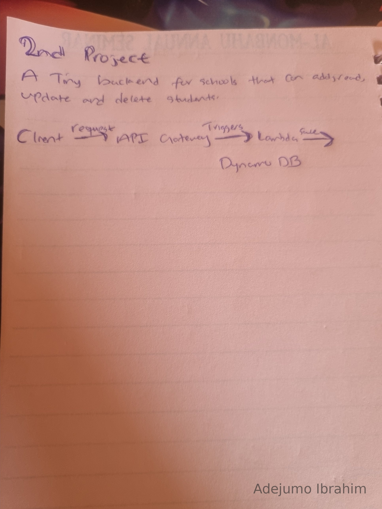

**Draft 2** added the four routes, the CloudWatch Logs link, the return path to the client, and the table details. It was still missing the IAM role. I added that during the build, once I understood that Lambda can't touch DynamoDB without one.

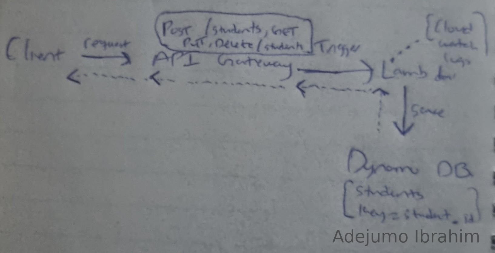

## Build steps

### 1. DynamoDB table
Created table `Students` with partition key `student_id` (String), no sort key, on-demand capacity. Only the key is defined up front because DynamoDB is schemaless; Lambda adds `name`, `class` and `email` when it saves a student.

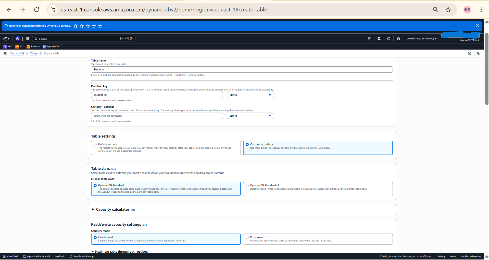
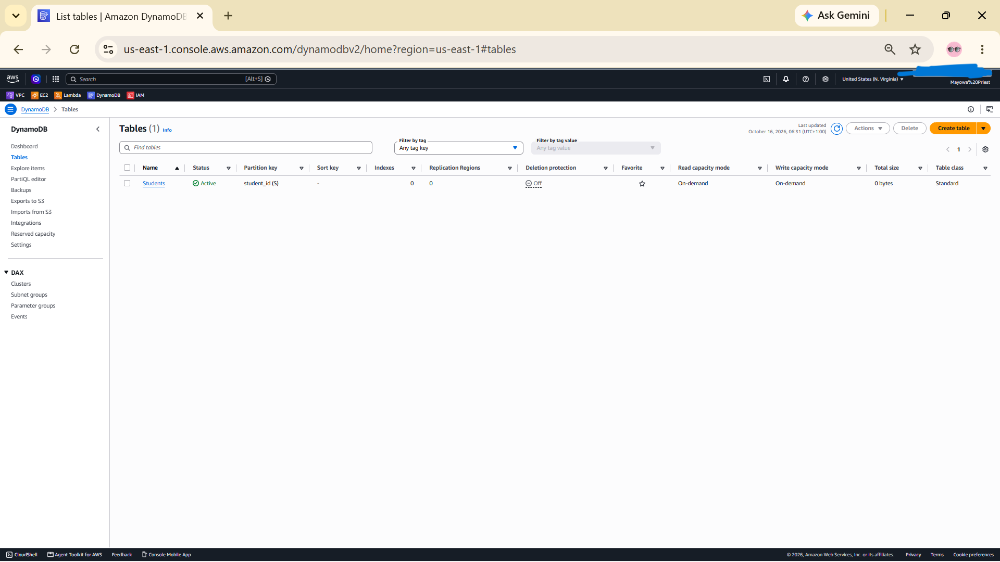

### 2. IAM role (least privilege)
Created `students-api-lambda-role` with two permissions:
- `AWSLambdaBasicExecutionRole` (AWS managed) for CloudWatch Logs
- An inline policy allowing only `PutItem`, `GetItem`, `UpdateItem` and `DeleteItem`, scoped to the `Students` table ARN and nothing else

Each action matches one route, and the role cannot touch any other table in the account.

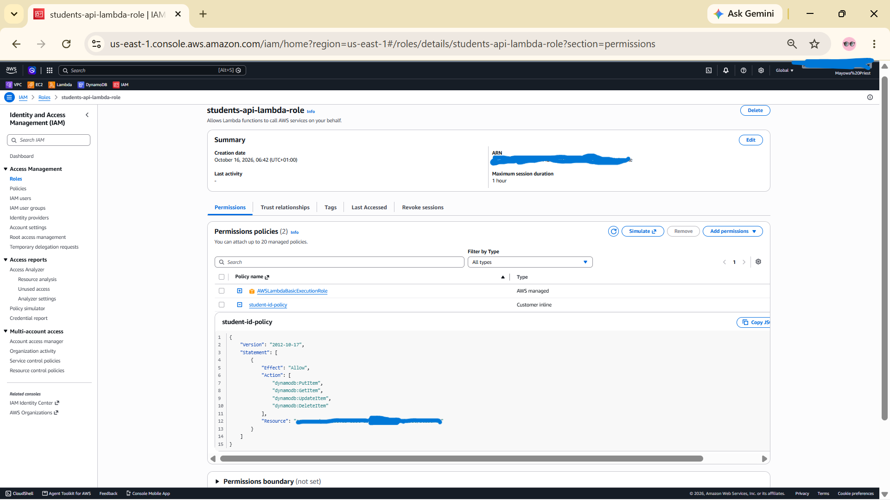

### 3. Lambda function
Created `students-api` (Python runtime) using the existing role above, then deployed the code in [`lambda_function.py`](lambda_function.py). One function handles all four routes by reading the HTTP method from the event.

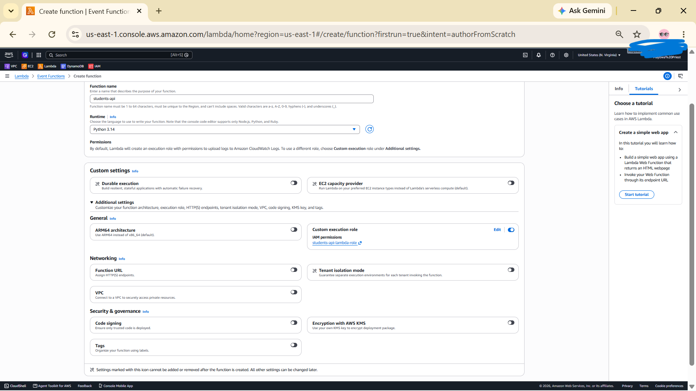
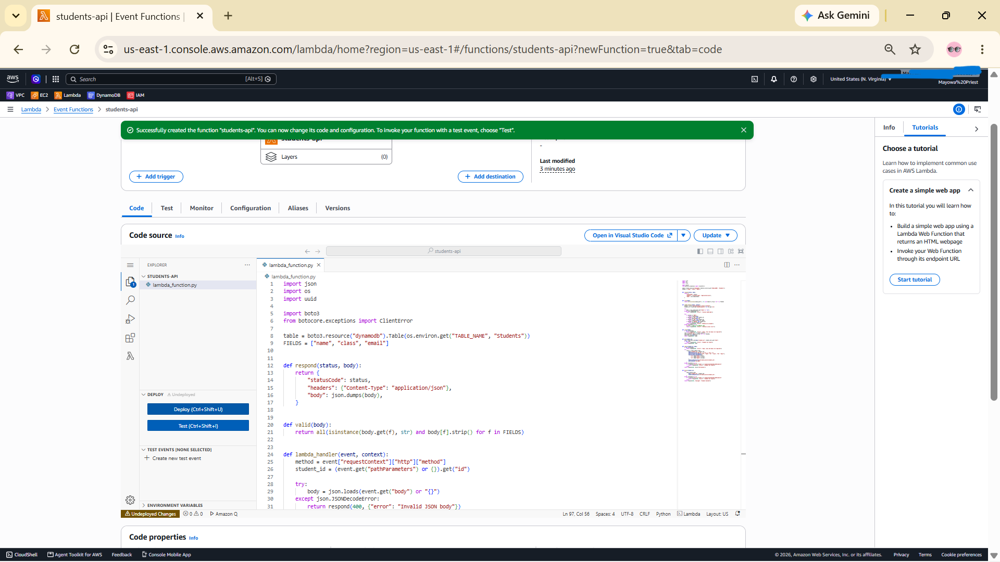

### 4. API Gateway (HTTP API)
Created `students-api-http` with the four routes, all pointing to the same Lambda integration, and a `$default` stage with auto-deploy on. The `{id}` in the path is what Lambda reads as `pathParameters["id"]`.

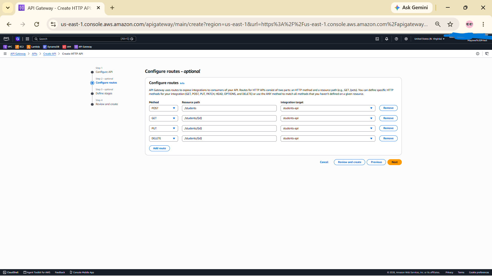
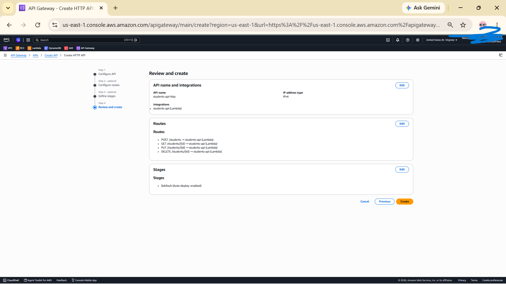

API Gateway added the permission to invoke the Lambda automatically. The function overview shows it as a trigger. It lists 2 triggers rather than 4 because the routes are grouped by path (`/students` and `/students/{id}`).

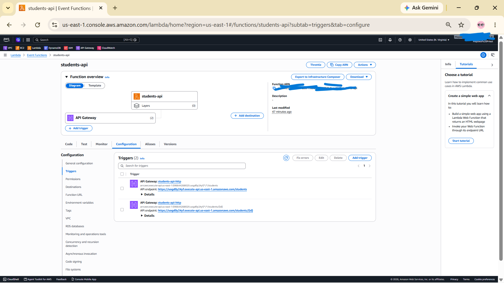

## Testing

I tested with `curl` from CloudShell, including the error cases.

| Test | Expected | Result |
|---|---|---|
| `POST /students` (valid body) | 201 | 201 |
| `GET /students/{id}` | 200 | 200 |
| `PUT /students/{id}` (class SS2 → SS3), then GET again | 200, change saved | 200, SS3 confirmed |
| `POST /students` with missing fields | 400 | 400 |
| `GET /students/does-not-exist` | 404 | 404 |
| `PUT /students/does-not-exist` | 404 | 404 |
| `DELETE /students/{id}` | 200 | 200 |
| `GET` the same ID after delete | 404 | 404 |

**Happy path:** POST, GET, PUT, then GET again to confirm the update was saved.

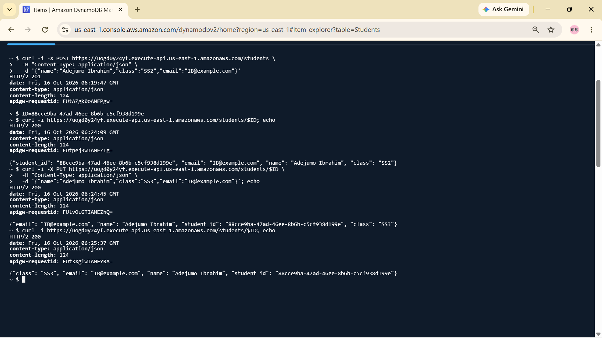

**Error cases:** missing fields (400), unknown ID on GET (404), unknown ID on PUT (404).

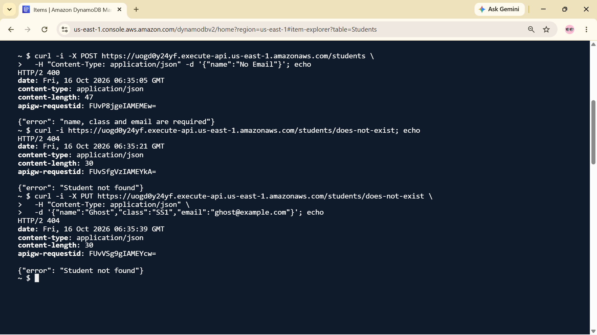

**Delete:** DELETE returns 200, then GET on the same ID returns 404, proving the record is gone.

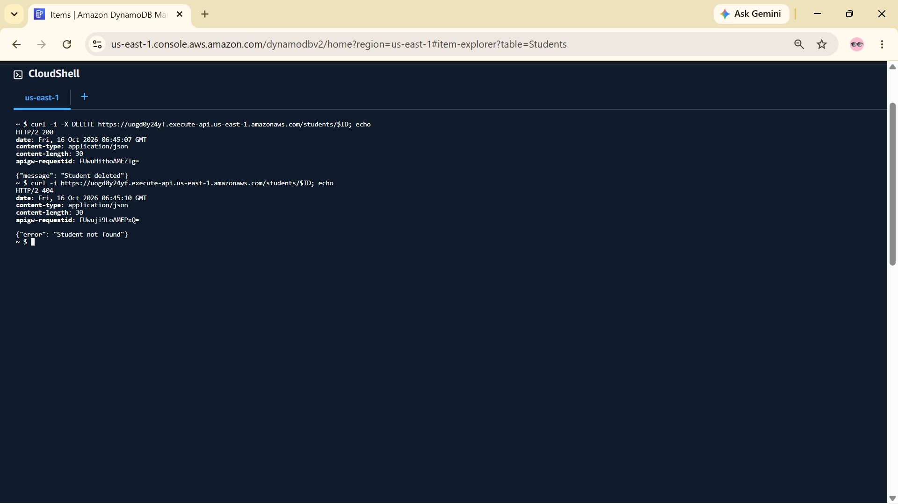

**Logging:** Lambda wrote a log stream to CloudWatch for each batch of requests, so the Lambda → CloudWatch Logs link from my sketch works.

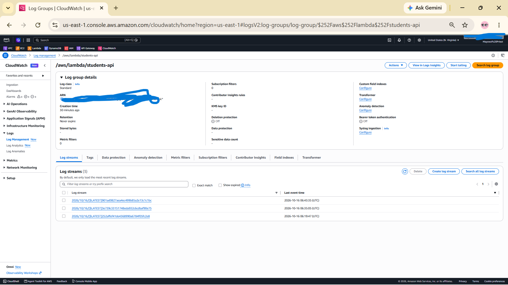

**Table after delete:** the table is empty.

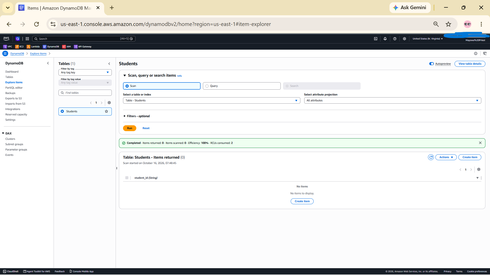

## Issues and lessons

1. **My first sketch had no IAM role.** Even my second draft left it out. Lambda has no permission to reach DynamoDB or write logs until a role grants it, so the role became the second thing I built, right after the table.
2. **`name` is a reserved word in DynamoDB expressions.** The update uses placeholders (`#n`, `#c`, `#e`) through `ExpressionAttributeNames`, so `name` and `class` don't clash with reserved words.
3. **An update on a missing item silently creates it.** In DynamoDB, `UpdateItem` creates the item if it doesn't exist, so `PUT` on an unknown ID would have created a "ghost" student. A `ConditionExpression` (`attribute_exists(student_id)`) makes `PUT` and `DELETE` return a proper 404 instead.
4. **A lost shell variable gave me a 405.** My first DELETE test returned `405 Method not allowed` because CloudShell had lost the `$ID` variable, so the URL ended at `/students/` with no ID. My Lambda only handles GET and DELETE when it has an ID, so it refused the request correctly. I now run `echo $ID` before every test.
5. **`curl` output hides in CloudShell.** `curl` doesn't print a newline after the body, so the response sat against the prompt and was redrawn away. Adding `; echo` after each command fixed it.
6. **`POST` generates the ID.** The client never picks `student_id`. Lambda creates a UUID, which avoids clashes and keeps IDs unguessable.
7. **Lambda doesn't clean up its own log group.** CloudWatch created `/aws/lambda/students-api` automatically, and it has to be deleted separately.

## Cost and teardown order

Lambda, API Gateway and DynamoDB on-demand all bill per request, so a project this small should cost close to nothing. The two things that could linger are the CloudWatch log group (it stores logs and its retention was "Never expire") and the DynamoDB table.

Teardown order, the reverse of the build, so nothing points at something already deleted:

1. API Gateway: delete `students-api-http`
2. Lambda: delete `students-api`
3. CloudWatch: delete the log group `/aws/lambda/students-api`
4. IAM: delete `students-api-lambda-role` (the inline policy goes with it)
5. DynamoDB: delete the `Students` table

After the teardown I checked each console to confirm nothing was left. I'll also check the AWS bill for any unexpected charges.

## What I would improve

- **Add authentication.** The API is open to anyone with the URL. I'd add an authorizer (Cognito or an IAM/JWT authorizer) before using it for real student data.
- **Set a log retention period** (for example 7 days) instead of "Never expire".
- **Validate input properly:** email format, length limits and field types, not only "present and non-empty".
- **Add `GET /students`** to list students, with pagination.
- **Add throttling and CORS** on the API so a browser front-end can use it safely and abuse is limited.
- **Define it as code** (SAM or Terraform) so the build and teardown are repeatable instead of manual console clicks.
- **Split Lambdas per route** so each function gets only the one DynamoDB permission it needs.
- **Automated tests** for the handler logic, and structured logging for easier debugging.
- **Return JSON for unknown routes.** API Gateway answers those itself in its own format.
